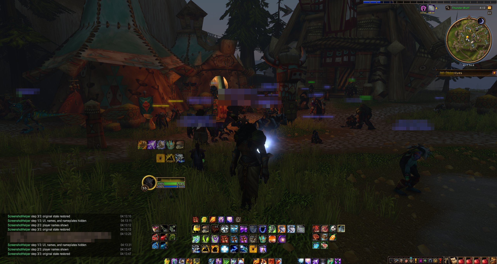
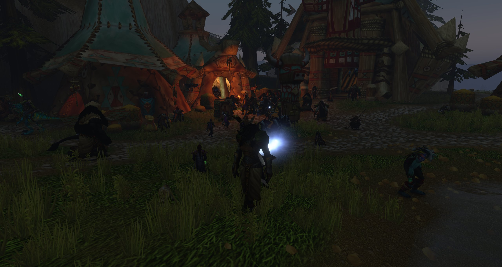
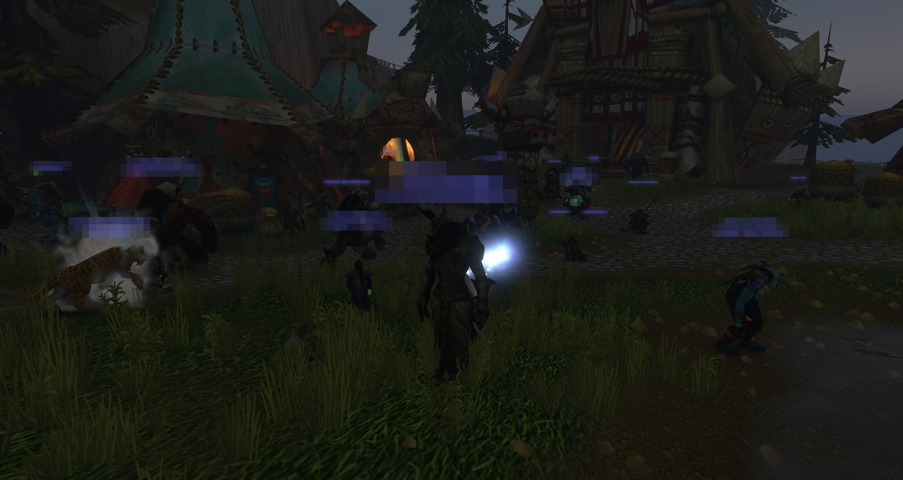
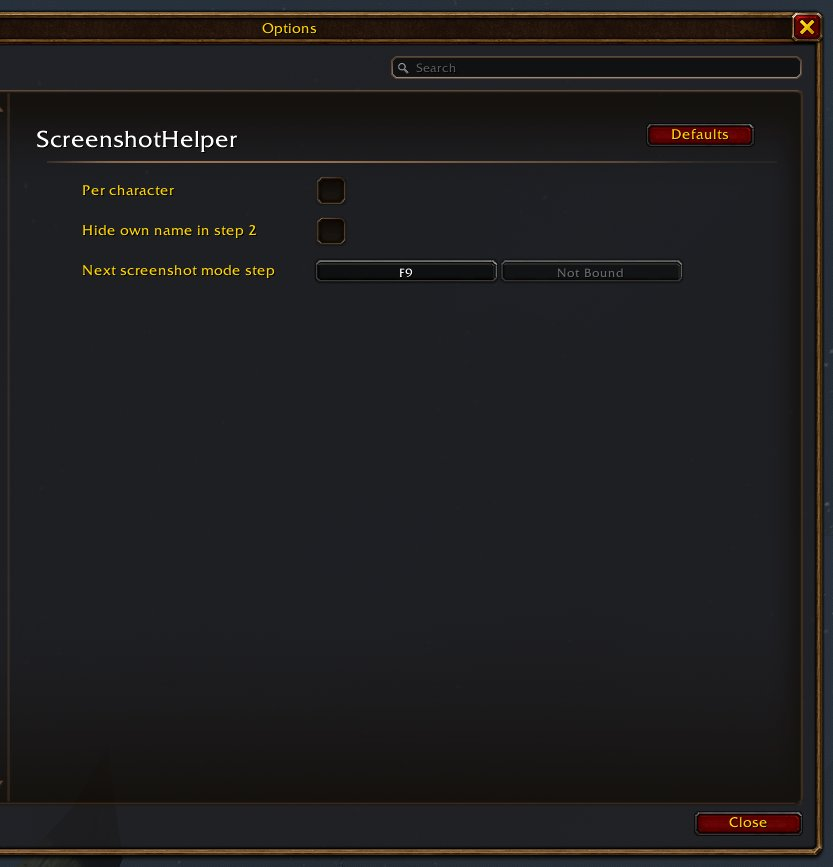

# ScreenshotHelper

Screenshot mode for WoW Forever in three steps on one key: hide the UI, all unit names,
and nameplates; show player names again; restore the original state.

## Features

- **Step 1** - hides the UI, all unit names, and nameplates; remembers what was on.
- **Step 2** - shows player names again; your own name too, unless hidden by option.
- **Step 3** - restores the original UI, names, and nameplates.
- **Key binding** - assign a key on the addon's settings page or under Options >
  Keybindings > AddOns; both set the same binding.
- **Safe** - after a reload or disconnect during the steps, names and nameplates come
  back on the next login.
- **Remembered** - settings are saved per account, or per character with one checkbox;
  default is off.
- **Settings page** - all options in the game menu under Options > AddOns, also opened
  from the addon compartment menu.
- **Chat commands** - every option can also be changed by slash command.
- **German** - texts in German on German clients, English everywhere else.

Take the screenshots yourself with the game's screenshot key. Not available in combat
(the game blocks changing nameplate settings there).

## Screenshots

Normal view, before step 1 and after step 3:



Step 1, UI, names, and nameplates hidden:



Step 2, player names shown:



Settings page with the key binding:



## Install

1. Download `ScreenshotHelper-vX.Y.Z.zip` from the
   [releases](https://github.com/tf4482/ScreenshotHelper/releases).
2. Unzip it into `World of Warcraft/<client folder>/Interface/AddOns/`.
3. Restart the game.

## Usage

```text
/ssh                  next step (1 hide all, 2 player names, 3 restore)
/ssh status           show the current step and settings
/ssh hideown on       hide your own name in step 2
/ssh hideown off      show your own name in step 2 (default)
/ssh character on     use settings for this character only
/ssh character off    use the account settings again
/ssh config           open the settings page
/ssh help             list all commands
```

## Examples

- Scenery shot: press the key once, press `Print`, press the key twice to restore.
- Group photo with names: press the key twice, press `Print`, press once more.
- Both versions: key, `Print`, key, `Print`, key.
- Others only: `/ssh hideown on`, then step 2 shows only other players' names.
- Set the key: `/ssh config`, click the "Next screenshot mode step" button, press e.g.
  `Shift-F12`.
- Macro: a macro with the line `/ssh` works on an action bar button.

## Develop

Check the code with [Luacheck](https://github.com/lunarmodules/luacheck) before each commit
(CI runs it on every push):

```text
luacheck .
```

Release: push an annotated tag `vX.Y.Z`; GitHub Actions packages the addon with the
BigWigs packager and publishes it.

## License

All rights reserved, see [LICENSE](LICENSE).
